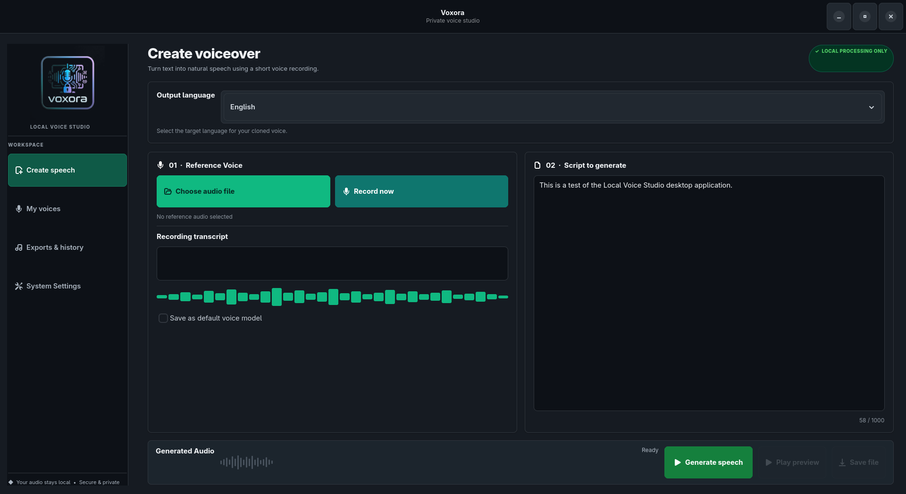

# Voxora

**Private, local voice cloning for English, Hindi and Kannada.** Record or import a short voice sample, enter its exact transcript, paste the text you want spoken, and generate a WAV file on your own computer.

Voxora is a native Linux desktop application built with GTK 4 and libadwaita. It does not open a browser, start a localhost web server, require an account, or call a paid inference API.



## Brand assets

The supplied Voxora logo is used in the desktop sidebar and installed application icon.

## Features

- Local zero-shot voice cloning for English, Hindi and Kannada using F5-TTS.
- Import or record reference audio from 3 seconds to 1 hour. F5-TTS uses a clean representative segment (up to about 12 seconds) for speaker conditioning; the full recording is analysed for acoustic statistics.
- Continuous **0–100 voice controls** for speaking speed, reference adherence, prosody variation, loudness, pitch/register, sentence intonation, brightness, warmth, breathiness, resonance, compression, reverb, sentence spacing, emphasis, mood intensity and synthesis detail.
- Real F5-TTS inference controls are mapped to model parameters. Local audio DSP controls are distinguished from neural speaker identity controls.
- Sentence markup for pauses, speed overrides, delivery tags and emphasis.
- Speaker analysis, persistent local profile and reference/generated acoustic comparisons.
- Long scripts are split into model-sized batches. Runtime depends on text length, CPU/GPU, memory and model.
- GStreamer playback with pause/resume; WAV export and local generation library.
- CUDA acceleration when available and CPU fallback.
- Offline inference after model weights have been downloaded; no API key or paid inference service.

See [Voice Controls](docs/VOICE_CONTROLS.md) for exact mappings and limitations. Not every vocal property is independently controllable by F5-TTS; unsupported neural features are documented rather than represented by fake sliders.

## Supported systems

- Fedora (GNOME recommended)
- Ubuntu / Debian-based Linux desktops
- Arch Linux and derivatives

The current native desktop UI uses GTK 4 and libadwaita and is **Linux-only**. Windows and macOS desktop installers are not currently shipped. The inference code may be portable, but a maintained cross-platform UI port and per-OS audio/device testing are required first. See [CONTRIBUTING.md](CONTRIBUTING.md) for the platform roadmap.

## Requirements

- Python 3.11 or 3.12 for the inference environment.
- GTK 4, libadwaita, PyGObject and GStreamer base/good plugins for the desktop UI and audio preview.
- FFmpeg and ALSA utilities for audio conversion and microphone recording.
- 8 GB RAM minimum; 16 GB or more recommended.
- NVIDIA GPU with 6 GB VRAM recommended for faster generation. CPU inference works but can be substantially slower.
- Several GB of free disk space for Python dependencies and model weights. Kannada's published checkpoint is especially large.

## Install

Clone the repository:

    git clone https://github.com/PSP-YN/Voxora.git
    cd Voxora
    chmod +x install.sh
    ./install.sh

The installer installs system libraries using your distribution's package manager, creates an isolated Python environment, installs F5-TTS, registers the desktop launcher and offers to download all three language models.

To skip system package installation (only do this if GTK 4, libadwaita, PyGObject, GStreamer, FFmpeg and ALSA utilities are already installed):

    ./install.sh --no-system-deps

To install the Python environment and desktop launcher without downloading model weights:

    SKIP_MODEL_DOWNLOAD=1 ./install.sh

Download models later:

    .venv/bin/python download_models.py

Or download only selected models:

    .venv/bin/python download_models.py --languages English Hindi

Launch from your Applications menu as **Voxora**, or run:

    ./run.sh

## Create speech

1. Open **Voxora**.
2. Choose English, Hindi or Kannada.
3. Import a clean 3-second to 1-hour recording or use **Record**. F5-TTS uses a representative clean segment (up to about 12 seconds) for cloning; the full source is analyzed for audio-level statistics. A clean 5–12 second segment is still a useful starting point.
4. Enter the exact words spoken in that recording. The transcript should be in the same language as the reference sample.
5. Paste the text to generate. The editor has no fixed 1,000-character limit; long scripts are batched by F5-TTS.
6. Select a delivery preset, then tune the 0–100 controls. F5-TTS parameters and post-generation DSP effects are described separately in docs/VOICE_CONTROLS.md.
7. Select **Generate speech**. The first model load may take several minutes; long scripts can take substantially longer.
8. Use **Play preview / Pause preview / Resume preview** to control playback without restarting it. WAV files are stored in the local outputs/ directory.
9. Click **Analyze speaker profile** to measure the reference voice. The profile is persisted locally in `voices/speaker_profile.json`.
10. Select script text and use **Emphasize selection**, **Selected text · slower**, or **Selected text · delivery**. **Insert 500 ms pause** adds a pause marker at the cursor.

Script markup supported by the local worker:

- `[pause:500ms]` or `[pause:1s]`
- `[speed:0.9]slower phrase[/speed]`
- `[delivery:formal]formal passage[/delivery]`
- `[emphasis]important words[/emphasis]`

The app synthesizes marked sentence segments separately and stitches them together. This can increase generation time and may produce slightly different prosody at sentence boundaries.

For best results, record one speaker in a quiet room, keep the microphone at a consistent distance, and avoid music or background speech. A long recording is analyzed in full for measurable signal statistics, but the current F5-TTS preprocessing stage still selects a representative segment of up to about 12 seconds for voice conditioning. It does not learn a complete speaker-diarized prosody profile from an hour of speech. The presets are parameter mappings, not guaranteed acting directions. Independent controls for emotion, exact intonation contours, accent, timbre and phoneme-level inflection require a model that explicitly supports those controls or a separate prosody-conditioning system. The Mood preset is an indirect parameter approximation; pitch shifting is post-processing and may alter perceived timbre. Only clone your own voice or a voice you have explicit permission to use.

## Privacy and network use

Voice samples, transcripts and generated audio are stored on the computer. The inference worker enables Hugging Face and Transformers offline mode. The first-time installer downloads model weights from the upstream public repositories listed in MODEL-LICENSES.md; no inference request is sent to a hosted service.

Voxora does not require API keys, paid endpoints or a user account. Model terms are separate from the app licence: notably, the English F5-TTS pretrained weights are CC BY-NC 4.0 (non-commercial). Review MODEL-LICENSES.md before any commercial use.

## Project layout

    native_app.py          GTK 4 / libadwaita desktop UI
    native_backend.py      isolated F5-TTS inference worker
    download_models.py     public model downloader
    install.sh             Linux dependency and desktop integration setup
    run.sh                 launch the native app
    models/                downloaded local model assets (not committed)
    voices/                private reference recordings (not committed)
    outputs/               generated WAV files (not committed)

## Tests

Install development test tools and run backend validation tests:

    .venv/bin/python -m pip install -r requirements-dev.txt
    .venv/bin/python -m pytest -q tests/test_backend_validation.py

Run the full desktop-to-inference smoke test for each language (requires all models to be installed):

    /usr/bin/python3 native_app.py --self-test English
    /usr/bin/python3 native_app.py --self-test Hindi
    /usr/bin/python3 native_app.py --self-test Kannada

These smoke tests use the F5-TTS bundled demo reference audio. They do not establish similarity to your personal voice; that requires a recording you provide.

## Contributing

See [CONTRIBUTING.md](CONTRIBUTING.md) for development setup, testing expectations, pull request checklist and future scope.

## Releases

Tagged releases publish a clean Linux source bundle and SHA-256 checksum through GitHub Actions. This is a source package, not a self-contained binary installer: install Linux system libraries and Python/model dependencies using the included installer. Windows and macOS packages are not available until the desktop UI is ported and validated on those platforms.

## Uninstall

    ./uninstall.sh

This removes the desktop launcher and icon only. It intentionally leaves your model downloads, voice profile and generated exports untouched.

## Licence

The Voxora application code is MIT-licensed. Third-party model weights have separate licences and attribution requirements; see MODEL-LICENSES.md.

## Qt desktop shell (cross-platform UI foundation)

The GTK4/libadwaita application remains available through `./run.sh`. A Qt/PySide6 desktop shell is now available through `./run-qt.sh`:

Linux/macOS:

```bash
.venv/bin/python -m pip install -r requirements.txt
.venv/bin/python -m pip install -r requirements-qt.txt
./run-qt.sh
```

Windows (PowerShell):

```powershell
.venv\Scripts\python.exe -m pip install -r requirements.txt
.venv\Scripts\python.exe -m pip install -r requirements-qt.txt
.\run-qt.bat
```

The Qt shell reuses the same local inference worker, voice recordings, models, generated WAV files and profile data. It launches the worker with the active Python interpreter, so the Qt entry point does not assume a Unix `.venv/bin/python` path. The UI is built on Qt Widgets and Qt Multimedia for playback and microphone capture. Model-specific loading and synthesis are routed through `model_adapters/`; the UI does not call F5-TTS directly. The existing GTK shell is retained during the migration rather than removed before feature parity is proven.

**Platform status:** The Qt shell uses Qt Multimedia for microphone capture and playback, replacing the GTK client’s Linux-specific recording path. This is a cross-platform implementation, not proof of validated Windows/macOS support: native audio devices/codecs, inference dependencies, GPU runtime, installers, signing and packaging still need testing on those operating systems.
